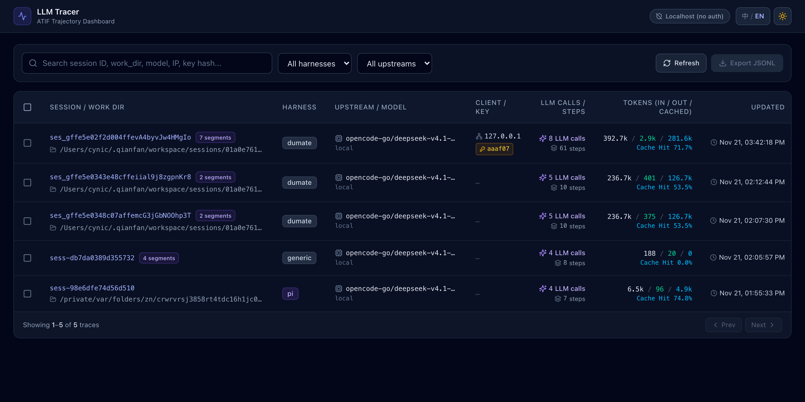
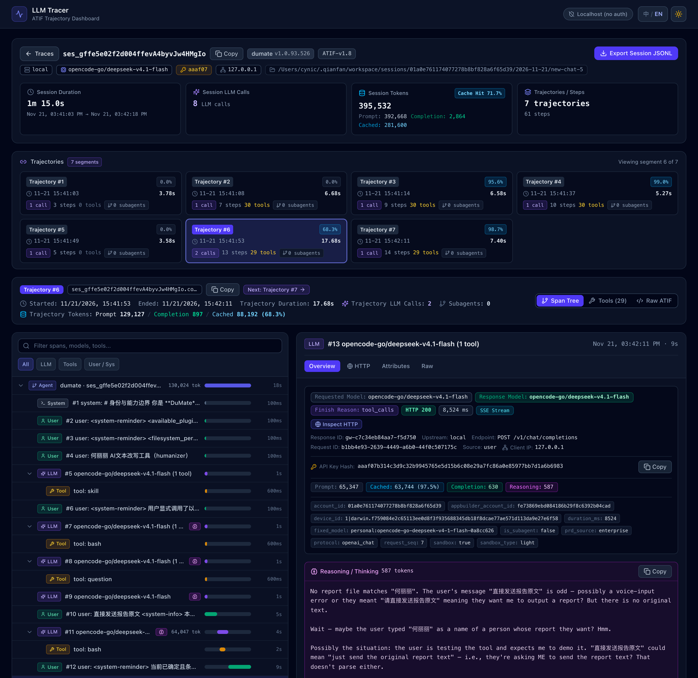
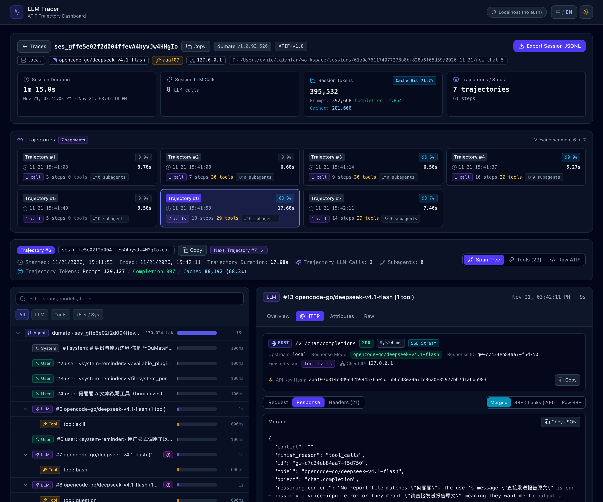
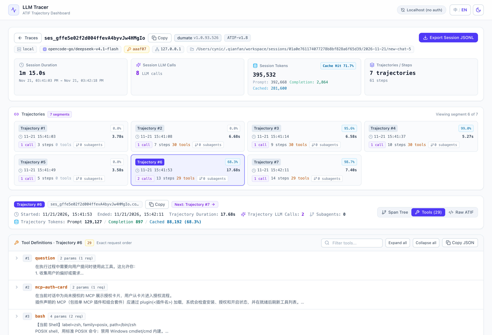

# llm_tracer

**单二进制 Go LLM 透明代理与 ATIF-v1.8 轨迹追踪器（内置 TypeScript 可视化 Dashboard）**

`llm_tracer` 作为透明反向代理部署在 AI Coding Agent（如 **Pi**、**DuMate**、**Claude Code**、**Codex**、**OpenCode** 等）与上游 LLM API（OpenAI / Anthropic 及兼容接口）之间：在**字节级不篡改请求与流式响应**的前提下，自动采集每一次 HTTP 交互、识别 Agent Harness 与工作目录、按严格前缀不变式聚合为 **ATIF-v1.8** 轨迹，并通过内置 Web Dashboard 提供可视化排障、KV Cache 命中率分析与批量 JSONL 导出。

---

## 核心特性

- **字节级透明代理**：完整透传 OpenAI（`/v1/chat/completions` 等）与 Anthropic（`/v1/messages` 等）协议的流式（SSE）与非流式请求，不修改业务报文，不托管上游 API Key（URL-only 透传）。
- **ATIF-v1.8 严格多轨迹续写**：遵循 append-only 前缀不变式，自动处理上下文前缀变更（生成 `continued_trajectory_ref` 链式续写分段与 `is_copied_context` 标记）以及主/子智能体协作（`subagent_trajectories` 与 `subagent_trajectory_ref`）。
- **多 Harness 自动识别**：开箱支持 **Pi**、**DuMate**、**Claude Code**、**Codex**、**OpenCode** 及通用客户端（Generic），自动提取 Agent 版本号、Session ID、工作目录（`work_dir`）与扩展元数据。
- **双轨数据持久化**：
  - **轻量 SQLite 索引**：仅存储会话摘要、请求元数据、脱敏请求头、Token 统计及 RawLog 帧定位索引 `(rawlog_file, rawlog_offset, rawlog_length)`，不在 SQLite 内联保存大报文。
  - **多帧拼接 Zstd 原始日志**：按天追加写入 `data/logs/requests-YYYY-MM-DD.jsonl.zst`（每条记录独立 Zstd Frame），支持 O(1) 随机定位按需解压，同时原生兼容 `zstd -dc` 与内置 `-dump` 命令。
- **单二进制嵌入式 Dashboard**：基于 React + TypeScript + Vite 构建并通过 `//go:embed` 打入单个 Go 可执行文件，支持 **浅色 / 深色（Light / Dark）主题** 与 **中文 / 英文（ZH / EN）界面**。
- **Raw HTTP & SSE 深度检视**：内置 HTTP Inspector，支持流式 SSE 的 **Merged（聚合视图）**、**SSE Chunks（逐帧视图）** 与 **Raw SSE** 切换，以及按请求顺序展示 Tools Schema。
- **安全与审计**：自动对请求头中的 API Key 进行脱敏，仅保存 **SHA-256 哈希前缀** 与 **Client IP**；支持可选的 `dashboard_key` 登录鉴权与非本机无鉴权安全警告。

---

## 界面预览

### 1. 会话列表与多维度筛选（Dark Mode）


### 2. ATIF-v1.8 多轨迹分段、Span 时间线与 Reasoning 检视


### 3. Raw HTTP & SSE Merged / Chunks 检视器


### 4. Light Mode 与有序 Tools Schema 检视


---

## 快速开始

### 方式一：下载预编译二进制（推荐）

前往 [GitHub Releases](https://github.com/ninehills/llm_tracer/releases) 下载对应平台的单二进制压缩包（支持 `linux/amd64`、`linux/arm64`、`darwin/amd64`、`darwin/arm64`），解压后直接运行：

```bash
# 以 macOS Apple Silicon 为例（按实际版本与平台替换文件名）
tar -xzf llm_tracer-v0.1-darwin-arm64.tar.gz
./llm_tracer
```

> **零配置开箱即用**：不带 `-config` 参数直接运行 `./llm_tracer` 时，若当前目录不存在 `config.toml`，程序会自动生成默认 `config.toml`（监听 `127.0.0.1:8080`，预置 `openai` 与 `anthropic` 上游）并自动创建 `./data/` 与 `./data/logs/` 目录。启动后直接访问 `http://127.0.0.1:8080`。

### 方式二：从源码编译

环境要求：Go 1.25+、Node.js 20+ & npm（用于编译内置前端）。

```bash
make build
./llm_tracer
```

> `make build` 会先在 `web/` 中执行 `npm install && npm run build` 生成 `web/dist/`，再执行 `go build -o llm_tracer .` 将前端静态资源直接嵌入二进制文件。

如需自定义端口或上游配置，也可基于示例文件启动：

```bash
cp config.toml.example config.toml
# 按需编辑 config.toml 中的监听地址与上游 URL
./llm_tracer -config config.toml
```

---

## 配置说明（`config.toml`）

`config.toml` 采用严格校验（不允许未声明的字段，且上游**严禁**配置 `api_key`，确保密钥仅由客户端透传）：

```toml
# 服务监听地址（默认 127.0.0.1:8080；示例使用 13425）
listen = "127.0.0.1:13425"

# SQLite 数据库文件路径（默认 ./data/llm_tracer.db，自动创建父目录）
sqlite_path = "./data/llm_tracer.db"

# 按天追加的多帧 Zstd 原始日志目录（默认 ./data/logs，自动创建目录）
raw_log_dir = "./data/logs"

# Dashboard 访问密钥；留空表示免登录
# 注意：当 listen 为非本机地址（如 0.0.0.0:13425）且 dashboard_key 为空时，
# 服务端会打印安全警告，Dashboard 顶部也会显示非本机无鉴权提醒横幅
dashboard_key = ""

# 上游定义：映射为 /proxy/<name>/*，仅配置 url，不存储 API Key
[upstreams.openai]
url = "https://api.openai.com"

[upstreams.anthropic]
url = "https://api.anthropic.com"

[upstreams.local]
url = "http://127.0.0.1:8000"
```

| 配置项 | 默认值 | 说明 |
| :--- | :--- | :--- |
| `listen` | `127.0.0.1:8080` | HTTP 监听地址（同时提供 `/proxy/*` 代理与 Dashboard） |
| `sqlite_path` | `./data/llm_tracer.db` | SQLite 数据库文件路径（WAL 模式，自动创建父目录） |
| `raw_log_dir` | `./data/logs` | 每日多帧 Zstd 原始请求/响应日志（`.jsonl.zst`）落盘目录 |
| `dashboard_key` | `""` | 非空时启用 Dashboard Cookie 登录鉴权；非本机监听强烈建议设置 |
| `[upstreams.<name>].url` | 必填 | 上游服务根地址（`http://` 或 `https://`），转发路径为 `/proxy/<name>/<path>` |

---

## 代理使用示例

代理路由格式为：

```text
http://<listen>/proxy/<upstream_name>/<original_api_path>
```

### 1. 使用 `curl`（OpenAI / Anthropic）

**OpenAI Chat Completions：**

```bash
curl -N http://127.0.0.1:13425/proxy/openai/v1/chat/completions \
  -H "Content-Type: application/json" \
  -H "Authorization: Bearer $OPENAI_API_KEY" \
  -d '{
    "model": "gpt-4o-mini",
    "stream": true,
    "messages": [{"role": "user", "content": "Hello from llm_tracer!"}]
  }'
```

**Anthropic Messages：**

```bash
curl -N http://127.0.0.1:13425/proxy/anthropic/v1/messages \
  -H "Content-Type: application/json" \
  -H "x-api-key: $ANTHROPIC_API_KEY" \
  -H "anthropic-version: 2023-06-01" \
  -d '{
    "model": "claude-sonnet-4-5",
    "max_tokens": 256,
    "stream": true,
    "messages": [{"role": "user", "content": "Hello from llm_tracer!"}]
  }'
```

### 2. 接入 Pi Agent

在自定义目录创建 `models.json`（例如 `~/.pi-tracer/models.json`）：

```json
{
  "providers": {
    "tracer-openai": {
      "baseUrl": "http://127.0.0.1:13425/proxy/openai/v1",
      "api": "openai-completions",
      "apiKey": "YOUR_OPENAI_API_KEY",
      "models": [
        {
          "id": "gpt-4o-mini",
          "name": "GPT-4o Mini",
          "reasoning": false,
          "input": ["text"],
          "cost": { "input": 0, "output": 0, "cacheRead": 0, "cacheWrite": 0 },
          "contextWindow": 128000,
          "maxTokens": 4096
        }
      ]
    },
    "tracer-anthropic": {
      "baseUrl": "http://127.0.0.1:13425/proxy/anthropic",
      "api": "anthropic-messages",
      "apiKey": "YOUR_ANTHROPIC_API_KEY",
      "models": [
        {
          "id": "claude-sonnet-4-5",
          "name": "Claude Sonnet 4.5",
          "reasoning": true,
          "input": ["text"],
          "cost": { "input": 0, "output": 0, "cacheRead": 0, "cacheWrite": 0 },
          "contextWindow": 200000,
          "maxTokens": 4096
        }
      ]
    }
  }
}
```

通过 `PI_CODING_AGENT_DIR` 运行 `pi`：

```bash
PI_CODING_AGENT_DIR=~/.pi-tracer \
  pi -p --provider tracer-openai --model gpt-4o-mini "帮我查看当前目录的 go.mod"
```

### 3. 接入 Claude Code / Codex / OpenCode / DuMate

只需将对应客户端的 API Base URL 指向 `llm_tracer` 的代理地址即可：

- **Claude Code**：
  ```bash
  export ANTHROPIC_BASE_URL="http://127.0.0.1:13425/proxy/anthropic"
  claude
  ```
- **Codex**：
  ```bash
  export OPENAI_BASE_URL="http://127.0.0.1:13425/proxy/openai/v1"
  codex
  ```
- **OpenCode**：在 Provider 配置中将 `baseURL` 设为 `http://127.0.0.1:13425/proxy/openai/v1`（或 `/proxy/anthropic`）。
- **DuMate**：在自定义模型设置中将 Base URL 设为 `http://127.0.0.1:13425/proxy/local/v1`（或任意已配置的 upstream）。关于 DuMate 的请求头特征、主/子智能体关联及 KV Cache 行为分析，详见 [docs/harness/dumate.md](docs/harness/dumate.md)。

---

## ATIF-v1.8 与数据存储

1. **轻量 SQLite 索引（`sqlite_path`）**：
   - `sessions` 表记录会话级元数据（`session_id`、`harness`、`harness_version`、`work_dir`、`upstream`、`model`、`client_ip`、`api_key_hash`、`step_count`、`trajectory_count` 及汇总 Token）。
   - `requests` 表仅保存脱敏 Headers、耗时、Token 统计以及多帧 Zstd 定位索引 `(rawlog_file, rawlog_offset, rawlog_length)`，不内联保存原始请求/响应体与中间解析 JSON，大幅缩小数据库体积。查询详情与轨迹时按 `(rawlog_file, rawlog_offset, rawlog_length)` 进行 O(1) 随机 Seek 并按需解压。
2. **多帧拼接 Zstd 原始日志（`raw_log_dir`）**：
   - 每日追加写入 `data/logs/requests-YYYY-MM-DD.jsonl.zst`，每条 JSONL 记录作为独立 Zstd Frame 拼接落盘（含解压后的原始请求/响应正文、时间戳、Client IP、API Key SHA-256 哈希与 Harness 元数据），既支持 O(1) 单条随机读取，又完全符合标准多帧 Zstd 规范。
   - **本地导出为明文 JSONL**：
     ```bash
     # 输出到标准输出
     ./llm_tracer -dump data/logs/requests-YYYY-MM-DD.jsonl.zst
     # 导出到指定文件
     ./llm_tracer -dump data/logs/requests-YYYY-MM-DD.jsonl.zst -out output.jsonl
     # 也原生兼容标准 zstd CLI
     zstd -dc data/logs/requests-YYYY-MM-DD.jsonl.zst > output.jsonl
     ```
3. **ATIF-v1.8 严格前缀多轨迹**：
   - 当同一 Session 内连续请求满足有序 `tools` 一致且 `messages` 严格为前缀追加时，归入同一条轨迹。
   - 若发生历史消息重排、裁剪、临时提醒丢弃或工具集变更，自动切分新的续写轨迹并通过 `continued_trajectory_ref` 链式关联，复用历史步骤标记 `is_copied_context: true`。
   - 子智能体请求独立归档至 `subagent_trajectories`，并在父轨迹对应工具调用的 `observation` 上关联 `subagent_trajectory_ref`。
4. **批量 JSONL 导出**：
   - 在 Dashboard 勾选多个会话点击 **Export JSONL**，或调用 `POST /api/traces/export` 导出标准 ATIF-v1.8 NDJSON（`application/x-ndjson`）。

---

## 测试

- **自动化 E2E 测试**：[tests/e2e/run_e2e.py](tests/e2e/run_e2e.py)
  ```bash
  make build
  python3 tests/e2e/run_e2e.py
  ```
  覆盖 TOML 严格校验、3 种鉴权模式与非本机警告、OpenAI/Anthropic 字节级流式/非流式透明转发、真实 `pi` / `claude` Agent 多轮工具调用、多 Harness 识别、轻量 SQLite 索引与多帧 Zstd RawLog（含 `-dump` CLI）、ATIF-v1.8 Schema 校验与批量 JSONL 导出。
- **人工用户测试指南**：[tests/user/README.md](tests/user/README.md)（包含 Dashboard UI、Pi Agent 与 DuMate GUI + Subagent 验收清单）。

---

## 开源协议与致谢（License & Acknowledgments）

- 本项目基于 **MIT License** 开源，详见 [LICENSE](LICENSE)。
- 内置 Web Dashboard 使用了 [evilmartians/agent-prism](https://github.com/evilmartians/agent-prism) 的 `@evilmartians/agent-prism-types` 与 `@evilmartians/agent-prism-data`（MIT License），其 Trace 树形时间线与检视器界面亦深受 Agent Prism 启发。完整的第三方许可声明见 [THIRD_PARTY_LICENSES.md](THIRD_PARTY_LICENSES.md)。
